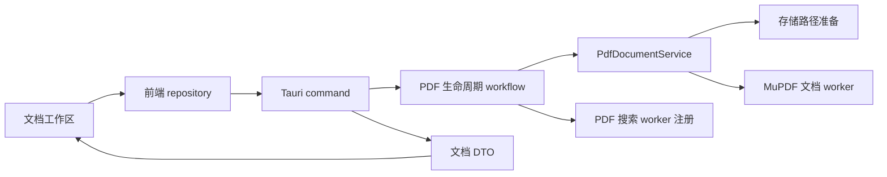

# Bambook 技术开发文档

本文档是开发入口，说明系统组成、关键概念和阅读顺序。软件定位、主要功能和快速启动参见[项目 README](../../README.md)。

本套文档依据 2026-10-22 工作区代码整理，对应应用版本 `0.1.0`。文中的“当前实现”表示代码中存在相应实现，不代表已经通过所有平台的运行验收；“待完善”表示尚未接通、存在限制或需要进一步验证。

## 001 · 系统组成

| 部分 | 主要技术 | 职责 |
| --- | --- | --- |
| 用户界面 | React 18、TypeScript | 标签页、文档工作区、编辑缓冲、导航和交互 |
| 桌面与通信 | Tauri 2 | 应用启动、原生窗口、对话框和 command / Channel 通信 |
| 应用后端 | Rust | 文档会话、解析、搜索、保存、导出与持久化 |
| 文档引擎 | MuPDF、pulldown-cmark | PDF 页面与文字提取、Markdown 结构化解析 |
| 数据与外部服务 | JSON、Reqwest | 文档库与设置存储、模型和翻译服务访问 |

前后端均按业务能力组织，后端在功能模块内部区分服务、端口和适配器。PDF 和 Markdown 共用文档生命周期管理，各自维护阅读或编辑状态。

## 002 · 代码地图

```text
Bambook/
├── src/
│   ├── app/                    应用入口、Provider 组合与布局
│   ├── features/               文档、PDF、Markdown、搜索、批注、设置等
│   ├── components/             共享视图及助手面板
│   ├── platform/               Tauri、窗口、对话框和服务调用适配
│   └── shared/                 缓存、尺寸计算和公共工具
├── src-tauri/
│   ├── src/
│   │   ├── app/                启动、装配、IPC 注册与跨模块流程
│   │   ├── features/           文档库、PDF、Markdown、搜索等功能模块
│   │   ├── platform/           系统打开、基础路径、文件 IO 与任务调度
│   │   └── shared/             公共错误和基础工具
│   ├── native/                 MuPDF 源码、Rust / FFI 封装及构建依赖
│   └── resources/              随安装包分发的资源与第三方声明
└── docs/developments/          本套技术文档
```

## 003 · 一次 PDF 打开的调用链



打开成功后，前端按需要分别请求页面结构和 PNG。原始文档句柄保留在 Rust worker 中；前端接收文档信息、文字坐标和页面图像。完整流程参见 [PDF 模块](modules/pdf.md)。

## 004 · 关键概念

| 概念 | 含义与边界 |
| --- | --- |
| `documentId` | 关联文档库、批注及附属数据的文档身份；新外部文档通常由规范化路径派生，未命名文档使用临时身份 |
| `sessionId` | 当前进程内的文档会话标识，供渲染、编辑、搜索和关闭使用，不能作为跨启动恢复依据 |
| `revision` | Markdown 会话的内容版本，编辑、保存、搜索和导出需要与相应版本对应 |
| `requestId` | 搜索等异步操作的请求序号，用于识别过期响应，与文档内容版本不同 |
| `path` / `sourcePath` / `dataPath` | 当前访问文件、来源文件、附属数据目录；托管副本场景下三者不能混用 |
| 未保存状态 | 前端协调关闭提示；Markdown 内容、PDF 批注和书签分别维护业务状态 |

## 005 · 阅读导航

| 文档 | 解决的问题 |
| --- | --- |
| [整体架构](architecture.md) | 系统边界、依赖方向、启动与关键流程 |
| [前端架构](frontend.md) | 组件、Provider、状态归属和代码放置 |
| [后端架构](backend.md) | 功能边界、依赖装配、线程与资源生命周期 |
| [后端重构记录](backend-refactor.md) | 完整目录、备份位置、职责迁移与验证结果 |
| [IPC 约定](ipc.md) | command、DTO、二进制响应、流式事件和错误 |
| [存储设计](storage.md) | 文档身份、存储目录、JSON 与恢复规则 |
| [文档模块](modules/documents.md) | 文档库、标签页、保存关闭与会话恢复 |
| [PDF 模块](modules/pdf.md) | 页面、坐标、搜索、批注和书签 |
| [Markdown 模块](modules/markdown.md) | 编辑缓冲、AST、revision、保存和导出 |
| [辅助阅读模块](modules/assistant.md) | 模型调用、流式回答及未接通的扩展 |
| [设置模块](modules/settings.md) | 设置加载、布局、默认值和迁移 |
| [测试与验收](testing.md) | 现有自动测试、验证命令与人工场景 |
| [开发与发布](build-and-release.md) | 环境、原生依赖、平台限制和打包 |

初次阅读建议从整体架构开始，再阅读前后端架构，最后沿所修改的业务进入模块文档。涉及数据或接口变化时，同时查阅存储设计与 IPC 约定。

## 006 · 维护约定

- 行为描述以实际注册、装配和调用链为依据；文件存在、按钮可见或编译成功都不足以证明业务完整。
- 业务文档引用统一的 IPC 和存储约定，避免重复维护字段定义和目录规则。
- 修改模型、持久化格式或生命周期时同步更新相关文档及验证方法。
- 规划放在各篇“待完善”中，完成后改写为当前行为；阶段进展记录可放入 `docs/logs/`，保留验证日期、平台与结果。
