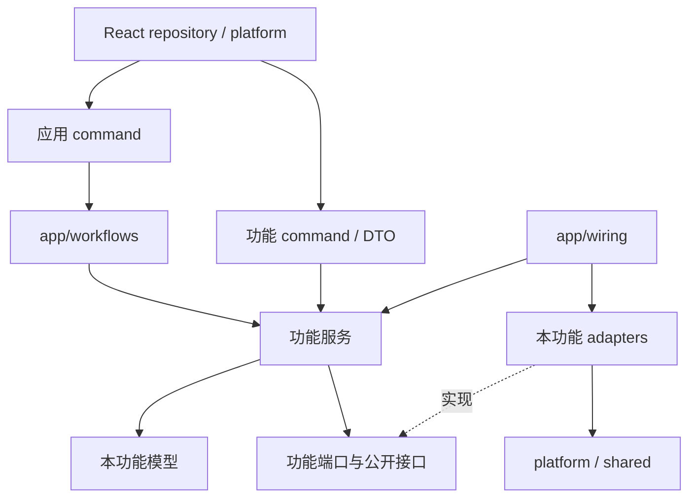

# 整体架构

[返回技术总览](README.md)

## 001 · 职责与边界

Bambook 是本地桌面文档应用。React 管理交互和编辑缓冲，Rust 管理文档会话、解析与磁盘数据，Tauri 连接两侧。模型与翻译服务是独立的外部依赖，通过 Rust 客户端访问。

PDF 是固定版式阅读文档，页面图像、文字层和应用批注分开呈现。Markdown 是可编辑文档，后端解析为项目自有 AST，再由 React 渲染。二者共用标签页、历史记录和关闭协调器。

## 002 · 功能模块与依赖

后端顶层按 `app`、`features`、`platform`、`shared` 组织。各功能通过 `mod.rs` 导出接口，内部实现默认私有；服务使用端口，具体引擎与仓库由应用统一装配。功能模块不依赖应用装配，底层公共模块不依赖功能模块。

文档库拥有文档身份、托管与索引规则；PDF 拥有书签和阅读位置格式；Markdown 拥有文件编辑与恢复；搜索通过提供者接口调用具体格式能力。跨模块流程归 `app/workflows`。详细目录见[后端架构](backend.md)。

## 003 · 启动流程

1. Rust [main.rs](../../src-tauri/src/main.rs) 调用库入口，随后进入 [bootstrap.rs](../../src-tauri/src/app/bootstrap.rs)。
2. Tauri 注册对话框插件，通过 `local_data_dir().join("Bambook")` 得到数据根目录。
3. [AppState::new](../../src-tauri/src/app/wiring.rs) 创建基础路径和文档库路径、初始化存储，并装配各功能服务与适配器。
4. `app/ipc.rs` 集中注册 commands；功能 command 获取本模块服务，应用 command 获取协调状态。未注册的函数不构成可用 IPC。
5. 前端 [main.tsx](../../src/main.tsx) 挂载应用，[AppProviders](../../src/app/AppProviders.tsx) 组合通知、设置、文档和两个业务工作区的 Provider。
6. 设置加载后，文档工作区按启动设置恢复磁盘文档、创建 Markdown 或展示开始页。

## 004 · 运行时状态

| 位置 | 保存内容 | 生命周期 |
| --- | --- | --- |
| React 文档工作区 | 标签、活动文档、文件夹、关闭询问、dirty 映射 | 前端挂载期间 |
| PDF 工作区 | 页码、缩放、选区、批注和书签编辑状态 | 文档与工作区使用期间 |
| Markdown 工作区 | 编辑缓冲、已保存基线、撤销栈和同步队列 | 文档打开期间 |
| Rust PDF 引擎 | 文档句柄和 worker 请求通道 | PDF session 打开期间 |
| Rust Markdown sessions | 源码、AST、目录、诊断和 revision | Markdown session 打开期间 |
| JSON 与文档文件 | 设置、文档库、内容和可恢复状态 | 跨进程持久化 |

`AppState` 保存服务引用，其服务内部可能保存会话；它不保存 React 的活动标签或选区。前端缓冲可能暂时领先于后端解析版本，保存前必须等待同步完成。

## 005 · 核心流程

### 打开与显示

文件选择或拖放进入文档工作区，后端识别类型，再调用 PDF 或 Markdown 打开接口。前端将返回数据映射为 `ReaderDocument`，由 [WorkspaceHost](../../src/app/layout/WorkspaceHost.tsx) 按 `kind` 展示对应工作区。

PDF 页面结构与位图分开请求；Markdown 打开即返回源码、AST 和目录。打开外部文档的准备阶段与首次保存入库分开，详见[存储设计](storage.md)。

### 编辑与保存

Markdown 输入先更新前端缓冲，再防抖同步到后端；保存和导出等待同步队列并携带最新 revision。PDF 标记与书签先更新前端状态，显式保存再写附属数据，阅读位置通过单独的自动保存路径更新。

跨文件保存由多个步骤完成。单个文件的原子替换不等于文档内容、文档库、metadata 和批注具有统一回滚事务。

### 关闭与恢复

关闭由统一协调器收集所有候选文档的决定，再执行保存等提交，最后释放会话和记录历史。取消询问会终止后续阶段；已经完成的磁盘写入不会因此回滚。

工作区恢复依据文件路径与文档类型重新建立会话。未命名 Markdown 使用独立恢复文件，目前恢复机制不能视为所有未保存文档的完整快照。

## 006 · 当前限制与演进方向

- 系统打开操作已集中到 platform/desktop：Windows 使用 explorer / rundll32，Linux 使用 xdg-open；桌面运行与安装包仍需在目标平台验收。
- 后端内部有类型化错误，IPC 当前仍将错误序列化为字符串。
- MCP 装配为空注册表；Agent 源文件未进入当前模块导出和启动装配链路。
- 工作区宿主当前按活动文档显示单个工作区，文件中保留的旧多窗格注释代码不属于运行实现。
- Markdown 预览与导出采用不同渲染链路，不能默认保证安全策略和样式完全一致。

新增能力时应同时检查前端入口、command 注册、服务装配、持久化和失败处理。具体限制与验证场景见各模块和[测试文档](testing.md)。
